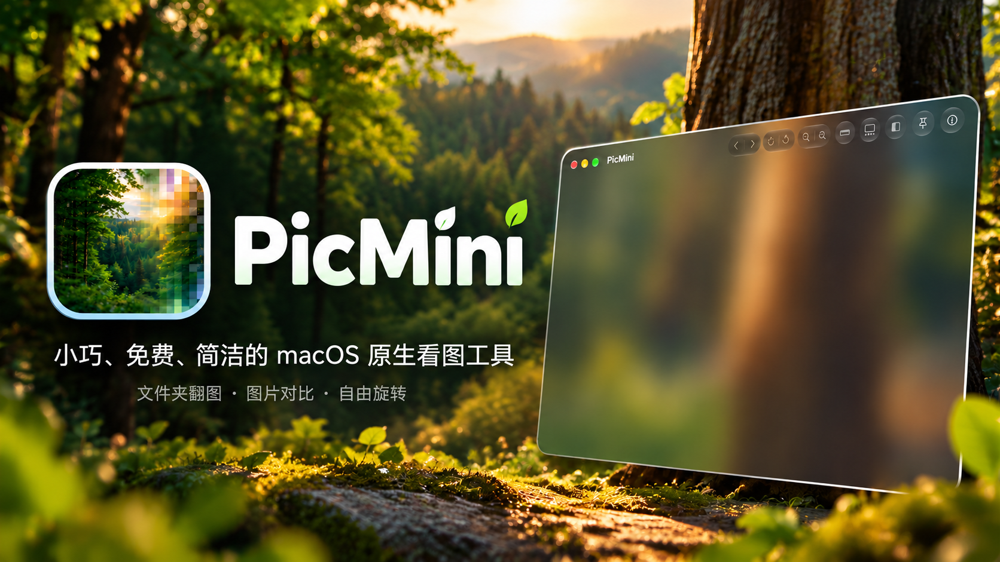

宣传示意图，实际界面随系统版本与设置而异。

<h1 align="center">PicMini</h1>

小巧、免费、简洁的 macOS 原生看图工具。

原生界面 · 轻量低占用 · 小体积 · 图片对比 · 免费使用

## 为什么选择 PicMini

**下载小，安装后也小。** 当前 0.1.42 版 DMG 安装包约 **527 KB**，安装后的应用本体约 **909 KB**。用系统自带的图像能力完成看图，无需随应用附带庞大的运行环境或第三方解码库。

**轻量低占用，把内存留给图片。** 空窗口按需创建组件，打开图片后才加载看图所需资源；邻图预加载受缓存预算控制，移出缓存范围及时释放，缩略图隐藏后也会释放位图。此前在开发者本机观察到空闲占用约 **33 MB**；这不是当前版本的固定指标，实际占用会随系统版本、图片尺寸、窗口数量和缓存设置变化。

**原生 Mac 界面，简洁又顺手。** 使用 Swift + AppKit 开发，保留熟悉的 macOS 窗口、磨砂背景与触控板交互。macOS 26 及以上还可开启顶部按钮的液态玻璃效果，图片区域保持干净。

**前后差异，拖一下就看清。** 自带滑动分隔线对比，将修改后的图片拖进窗口，就能与原图对照。适合检查修图、调色和设计调整，不必来回切换两个窗口。

**专注看图，免费使用。** 文件夹连续翻图、悬浮缩略图、自由旋转、窗口置顶和尺寸查看都放在手边；看图操作不修改原文件，也不需要导入图库。

体积数据来自当前 Apple Silicon 构建，按十进制 KB / MB 约计；应用本体大小不包含设置及系统管理的数据，后续版本可能变化。

## 为什么做 PicMini

我一直觉得 Mac 自带的预览就挺好的，简洁方便，但是不能很好地查看前后图片，而市面上的看图软件不是收费就是有太多我不想要的功能，我就想要一个小巧轻便的看图软件。得益于现在的 AI 智能体，我也可以将自己的想法付诸实现，得到了这款应用。

PicMini 保留简单的看图界面，把常用操作放在手边。打开图片就能浏览同一文件夹，底部没有常驻的信息栏，缩略图也只在需要时出现。

## 下载与安装

在本仓库的 **Releases** 中下载最新版本的 `PicMini-版本号.dmg`。

1. 打开 DMG，将 **PicMini** 拖入旁边的 **Applications（应用程序）**。
2. 复制完成后推出磁盘映像，从“应用程序”打开 PicMini。
3. 将图片或文件夹拖入窗口，即可开始浏览；也可以通过访达的“打开方式”使用 PicMini。

| 项目 | 要求 |
| --- | --- |
| 当前安装包 | Apple Silicon（M 系列芯片）Mac |
| 系统最低要求 | macOS 13 或更新版本 |
| 液态玻璃按钮 | macOS 26 或更新版本，可在设置中开启 |
| 价格 | 免费使用 |

当前版本尚未使用 Developer ID 签名和 Apple 公证，首次打开可能受到 macOS 安全机制拦截。

本仓库用于发布应用介绍和安装包，不包含应用源代码。

## 能做什么

- **顺手翻图**：浏览同一文件夹中的图片，按文件名自然排序，支持方向键切换和悬浮缩略图选择。
- **原生界面与窗口管理**：简洁磨砂界面，可选顶部液态玻璃按钮；支持单窗口、多窗口和窗口置顶，方便边看图边工作。
- **缩放与旋转**：鼠标滚轮缩放、左键拖动平移、右键拖动旋转，也支持触控板捏合和双指旋转；接近直角时自动吸附。
- **前后对比**：开启对比后拖入另一张图片，左侧为新图、右侧为原图，拖动中间的竖线查看修图、调色或设计修改的差异。
- **两种尺寸模式**：同一按钮切换像素 1:1 和实际物理尺寸，物理尺寸支持按显示器单独校准。
- **图片信息**：顶部显示像素尺寸、色彩模式、格式与图片序号，详细面板提供更多文件和色彩信息。
- **按需缓存**：可设置内存缓存预算，按翻图方向优先预加载，快速连续翻图时跳过尚未开始的中间解码任务。
- **按习惯设置**：自定义快捷键、按图片格式设置默认看图程序，以及查看和清理应用本地数据。

支持格式由 macOS 的图像解码能力决定，包括 JPEG、PNG、HEIC、TIFF 等常见格式；可关联的格式以“设置 → 默认看图”中的列表为准。

## 常用操作

| 操作 | 方法 |
| --- | --- |
| 上一张 / 下一张 | `←` / `→` |
| 放大 / 缩小 | 鼠标滚轮，或触控板捏合 |
| 移动图片 | 按住鼠标左键拖动，或触控板双指滚动 |
| 自由旋转 | 按住右键左右拖动，或触控板双指旋转 |
| 复位旋转 | 双击图片 |
| 图片详细信息 | 单击右键，或 `⌘I` |
| 像素 1:1 | `⌘2` |
| 实际物理尺寸 | `⌘1`，或单击鼠标中键 |
| 设置 | `⌘,` |

键盘快捷键可在“设置 → 快捷键”中修改。

### 悬浮缩略图

点击工具栏中的缩略图按钮启用，一排最多显示 15 张。支持鼠标滚轮、触控板横向滚动和拖动浏览，点击缩略图即可切换图片。

面板显示 2 秒后自动隐藏；鼠标停留在面板内时保持显示。隐藏后，将鼠标移到窗口底部停留 1 秒即可再次呼出。隐藏或关闭时释放缩略图位图。

### 图片对比

1. 打开作为参考的图片，点击顶部的对比按钮。
2. 将另一张图片拖入当前窗口。
3. 左侧显示新图，右侧显示参考图；左右拖动白色分隔线查看差异。

再次点击对比按钮即可退出。缩放、旋转和对比都只影响查看效果，不改写原图。

### 像素 1:1 与实际物理尺寸

**像素 1:1** 用于查看像素细节，不依赖图片 PPI。Retina 屏幕按 backing 像素计算；部分系统缩放模式下，backing 像素不等于显示面板的物理像素。

**实际物理尺寸** 用于按厘米查看图片。先进入“设置 → 屏幕校准”，用实体尺测量标称 10 cm 的校准线，调整滑块后保存。每块显示器独立保存校准值，显示缩放、分辨率或方向改变后需要重新校准。

图片含有效 PPI 时按其数值换算；缺失时按 **300 PPI** 计算并注明。300 PPI 是显示时的换算约定，不代表图片原本记录了该值，也不会写入图片。

## 更新与卸载

**更新**：先退出 PicMini，下载新版 DMG，将新版应用拖入“应用程序”并选择替换。保持安装位置不变，原有设置会保留，无需提前清理本地数据。目前采用手动下载更新。

**卸载**：如需清理设置，先在“设置 → 本地数据”中选择“清除本地数据并退出…”，再将应用移到废纸篓。清理不会删除看过的图片；默认打开方式等系统设置由 macOS 管理。

## 数据与当前限制

图片在本机读取和显示，应用不上传图片，也不建立图库。图片预加载缓存只保存在内存中；系统 Quick Look 的共享缩略图缓存由 macOS 管理。设置中的缓存预算不等于整个应用的内存上限。

- 动画和多页图片目前显示首帧或首页。
- 超大图片的解码长边限制为 8192 像素，显示为预览，深度放大不能查看全部原始细节。
- 对比参考图使用开启对比时已有的解码清晰度，放大时不会重新读取参考原图。
- HDR、RAW 和高位深显示效果尚未逐项验证。
- 低版本MacOS没有试过有没有bug，而且这是针对M芯片的。
## 反馈与作者
如果这款小工具对你有帮助，欢迎来 B 站关注我、交流使用体验：
**[潜入那片海\_ · B 站主页](https://space.bilibili.com/45680617)**
也可以在 B 站搜索：`潜入那片海_`。

如果 PicMini 刚好对你有帮助，愿意的话可以随缘赞助一杯咖啡；不赞助也完全不影响使用，感谢每一个使用和反馈。

  
  &nbsp;
  

微信收款码 · 支付宝收款码

